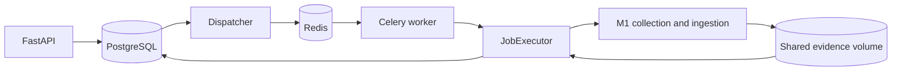

# M3 Worker Architecture

FastAPI creates a Collection Job and writes input, pinned Profile Version and hash, dispatch time, and creation event in one PostgreSQL transaction. API 201 confirms persistence. The Dispatcher is the only polling process and publishes JSON tasks from committed Jobs. Each payload carries only the Job UUID. Celery supplies a task ID and expiration. Redis provides broker transport, and PostgreSQL stores Jobs, dispatch, retries, and results.

The M5 review covers the full system, archived contracts, and verified capacity and access boundaries. [M5 Core Architecture Review](M5-core-architecture-review.md)

## Dispatch and recovery

- The Dispatcher polls every second, handling expired leases before due pending Jobs, up to 20 of each per pass. Each uses a short transaction with `FOR UPDATE SKIP LOCKED`, letting only one Dispatcher hold the Job's dispatch lock at a time.
- The publisher disables transport-level publish retry and sets Redis connect and socket timeouts to 2 seconds each. Failure records `DISPATCH_FAILED` and delays the Job by 5 seconds. That Dispatcher also pauses publication for 5 seconds. Published, unclaimed Jobs may be redispatched after 120 seconds. Messages expire after 120 seconds. Each dispatch has a new Celery task ID. While Redis is unavailable or messages are lost, pending Jobs remain in PostgreSQL and dispatch can continue when service recovers.
- The worker claims with the existing row lock, increments `execution_attempt`, and creates a fixed 90-second lease using PostgreSQL time. For expired running Jobs the Dispatcher records `WORKER_LOST`. With attempts remaining it retries after 5 seconds, otherwise it fails the Job. The worker and CLI reject retries that are not due.
- Result and failure handlers relock the Job and check state, attempt generation, and lease against PostgreSQL time inside the transaction. Another recovery or claim cannot replace the lock holder. If ownership has been lost, the log records the Job UUID and previous attempt. Committed Evidence metadata, Records, Quarantine, counts, and terminal event share one transaction.
- Files and PostgreSQL have separate write boundaries. Transient HTTP errors, stale completions, termination, and transaction rollback can leave unreferenced captures. Preserve them for investigation. With workers and CLI stopped, compare UUID directories under the Evidence root against `raw_evidence.id` and check `.capture-*` staging directories. Confirm database access and absence of references before acting.

## Celery

The stack uses Celery 5.6.3, Kombu 5.6.2, and redis-py 5.2.1. Compose uses private Redis 7.4.8 with AOF, 64 MiB maxmemory, and noeviction. Celery uses `CELERY_BROKER_URL`, JSON only, the `collection` queue, and `collection.execute_job`, with result backend disabled. Linux defaults are prefork concurrency 1, prefetch 1, a 60-second hard limit, and 180-second Redis visibility.

Normal results use late acknowledgement. Celery may acknowledge after failure, hard timeout, or prefork child loss, so PostgreSQL leases and the Dispatcher drive recovery. On broker connection loss, worker settings cancel long-running unacknowledged work. After a full worker crash, Redis can restore the message when visibility expires. PostgreSQL decides expired, not-yet-due, running, and terminal states. Windows solo is for local testing. Linux prefork defines hard-limit and signal behaviour.

## Compose trust boundary

The base configuration retains the existing PostgreSQL volume path. API and PostgreSQL publish to host loopback only, and Redis has no host port. API and worker share `/data/evidence` in `evidence_data` under the same non-root UID.

`compose.fixture.yaml` creates an internal network and sets `M3_COMPOSE_FIXTURE=1` only for API and worker. It permits the fixed literal origin `http://collection-fixture:8001` through private Compose DNS, with approved Source policy and existing robots, redirect, timeout, and request limits. The fixture serves its prescribed robots.txt and table.html. Use a dedicated test project to keep fixture-mode Sources out of development data.

## Limits

The guarantee covers at-least-once execution attempts and idempotent committed results. Two attempts may each send HTTP requests, subject to M1 per-request timeouts and robots and redirect limits. M3 controls retries and request counts for each Job using the existing M1 policy. Shared public-source quotas across Jobs, fleet heartbeats, Evidence retention, and backups remained for later verification.
