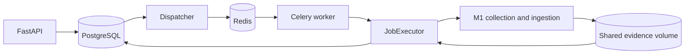

# M3 Worker Architecture

FastAPI 建立 Collection Job 時，在同一 PostgreSQL transaction 寫入輸入、固定 Profile Version／hash、派送時間及建立事件。API 201 表示 Job 已持久化。Dispatcher 是唯一的輪詢程序，從已提交的 Job 發布 JSON task。每個訊息只包含 Job UUID，Celery 另帶 task ID 和有效期限。Redis 提供 broker transport，PostgreSQL 保存 Job、派送、重試與結果。

M5 的全系統視圖、封存合約及已核對的容量／安全界限見 [M5 Core Architecture Review](M5-core-architecture-review.md)。

## Dispatch 與 recovery

- Dispatcher 每秒掃描，先處理 expired leases，再處理 due pending Jobs，每類每輪最多 20 筆。每筆使用短 transaction 與 `FOR UPDATE SKIP LOCKED`，同一 Job 同時只有一個 Dispatcher 持有派送鎖。
- Publisher 禁用 transport publish retry，Redis connect／socket timeout 各 2 秒。失敗記錄 `DISPATCH_FAILED` 並延後 5 秒，該 Dispatcher 亦暫停發送 5 秒。已發布且仍未 claim 的 Job 在 120 秒後可重派，派送訊息的有效期同為 120 秒。每次派送使用新的 Celery task ID。Redis 不可用或訊息遺失時，pending Job 仍然留在 PostgreSQL，派送嘗試可持續至服務復原。
- Worker 透過原有 row lock claim，遞增 `execution_attempt`，以 PostgreSQL 時間建立固定 90 秒 lease。Dispatcher 對過期 running Job 記錄 `WORKER_LOST`。若尚有額度，5 秒後可再執行，達上限則失敗。Worker、CLI 都會拒絕尚未到期的 retry。
- 結果與失敗處理都重鎖 Job row，在 transaction 內以 PostgreSQL 時間核對狀態、attempt generation 和 lease。持鎖期間無法被另一次 recovery 或 claim 取代。若已失去 ownership，會記錄含 Job UUID 和舊 attempt 的 log。已提交的 Evidence metadata、Records、quarantine、counts 和終態事件屬同一 transaction。
- 檔案與 PostgreSQL 有各自的寫入邊界。暫時性 HTTP 錯誤、stale completion、程序終止或 transaction rollback 均可能留下未被 DB 引用的檔案。保留這些資料供調查。停下 Worker 和 CLI 後，以 evidence root 下的 UUID 目錄對照 `raw_evidence.id`，另檢查 `.capture-*` staging 目錄。確認資料庫可用並核實沒有引用後才處理。

## Celery

使用 Celery 5.6.3、Kombu 5.6.2、redis-py 5.2.1。Compose broker 為 Redis 7.4.8，獨立的 private service，使用 AOF、64 MiB Redis maxmemory 和 noeviction。Celery 以 `CELERY_BROKER_URL` 指定 Redis URL，JSON-only，queue 為 `collection`，註冊 `collection.execute_job`，停用 result backend。Linux 預設 prefork concurrency 1、prefetch 1、hard task limit 60 秒、Redis visibility 180 秒。

Late ack 用於正常結果。Celery 可在 task failure、hard timeout 或 prefork child loss 後 ack，因此復原由 PostgreSQL lease 及 Dispatcher 主導。Broker connection loss 時，Worker 設定取消長時間執行的未 ack task。整個 Worker 崩潰時，Redis transport 也可能在 visibility 到期後恢復訊息。過期、未到期的 retry、running 及 terminal 狀態均由 PostgreSQL 判定。Windows 的 solo process 只供本機測試，hard task limit 與 signal 行為以 Linux prefork 為準。

## Compose trust boundary

基礎設定保留原有 PostgreSQL volume path。API 和 PostgreSQL port 只映射到 host loopback，Redis 無 host port。API 和 Worker 以相同非 root UID 共用 `evidence_data` 的 `/data/evidence`。

`compose.fixture.yaml` 建立 internal network 並只為 API、Worker 啟用 `M3_COMPOSE_FIXTURE=1`。這個模式額外接受固定字面 origin `http://collection-fixture:8001`，依賴專用 Compose network 的 service DNS，仍需批准的 Source policy 並維持 robots、redirect、timeout 及 request bounds。測試網站只提供指定的 robots.txt 和 table.html。此模式應使用專用測試 project，避免在開發資料保存需要 fixture 模式才可讀取的 Source。

## 界限

保證為 at-least-once execution attempts 與 idempotent committed results。兩次 attempt 可能各自發送 HTTP；M1 的單次 request timeout、robots 和 redirect 上限仍生效。M3 控制每個 Job 的重試和請求數，目前各獨立 Job 沿用既有 M1 policy。跨 Job 的共享 public-source quota、Worker fleet heartbeat、evidence retention 和備份仍待其他里程碑驗證。
