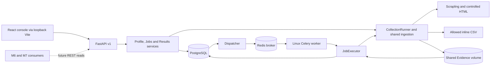

# M5 Core Architecture Review

2026-11-14 Hong Kong time. M4 delivery was `aabe86502d688ddb9000fd3e970a7c7fadcc49fc`. Backend, frontend, and Compose files matched `439e1a2b1e98f4d3bf53919ec07507e8df099ece`. The review used ADRs M0-01–03, M2-01–03, M3-01–04, and the M4 Closure contract. Formal human peer review remained to be scheduled. [M0 ADR](../decisions/M0-architecture-decisions.md) [M3 ADR](../decisions/M3-reliability-decisions.md)

| Boundary | Review finding |
| --- | --- |
| Modular monolith | API, CLI, and worker share the same Python package and contracts. API owns transport and DTOs. Application services own use cases, transactions, and errors. The Core owns input, adapters, validation, and identity. Persistence owns ORM, constraints, and migrations. Only the Dispatcher decides when to dispatch. |
| Source and Profile | Configuration and access policy are separate. Writes for a Source share a row lock. Validation performs I/O first and rechecks Source, Draft revision, and hash on write. Approval requires the current passing report and a DB trigger protects approved content. |
| Job and worker | Job and dispatch intent share a transaction. Dispatcher uses `SKIP LOCKED` for due rows. Worker claim increments the attempt and sets a fixed 90-second lease. PostgreSQL time and the Job lock fence stale attempts. Celery takes the Job UUID as JSON. Pending rows can be redispatched after Redis loses messages. |
| Integrity and Evidence | Shared ingestion validates and normalises, then keeps the first valid identity within a Job. Publish files to the Evidence volume first. The backend rereads bytes and metadata, then writes Evidence metadata, Records, Quarantine, counts, and terminal state in one database transaction. Composite foreign keys protect lineage. |
| Console and consumers | The console uses HTTP, replayable request keys, Draft revisions, and bounded polling. Downstream consumers can fetch terminal snapshots and validated Records by Job ID. |

## Findings and scope

| Priority | Risk and response |
| --- | --- |
| Fixed | Real loopback HTTP reproduced a discrepancy between robots checks and libcurl dot-segment normalisation in `backend/core/web_adapter.py`. Reject literal and decoded dot segments and encoded separators before issuing a request, and validate redirects again. Scrapling fetching disables its logger in the current context. The synthetic URL marker stays in Evidence lineage. |
| Fixed | `backend/core/html_extraction.py` retains the candidate-count limit and caps aggregate extracted text at 1 MiB UTF-8. A test with about 93 KB of HTML and global XPath triggers `extraction_size_limit` before repeated materialisation can amplify values. |
| Medium | `application/execution.py`, `queue/dispatcher.py`, and `application/jobs.py` share internal Job helpers and call private methods across modules. The lock order, lease checks, and terminal publication could share one coordination point. M5 retains the structure and tests transaction behaviour. |
| Medium | M1 `ProfileRepository` and M2's PostgreSQL layer represent lifecycle state separately. Application maps ORM rows to temporary snapshots to reuse M1 policy. DB writes use locks, constraints, and triggers. Recheck all three when changing the state machine. |
| Medium | Unclaimed Jobs can be redispatched during a broker outage, and `DISPATCH_FAILED` and unpaginated events can accumulate. The execution budget is 3 attempts. Source, Profile, and Events lists lack server pagination, and Evidence storage has no quota or retention policy. |
| Medium | `M3_COMPOSE_FIXTURE=1` affects Source DTO policy checks, including reads of existing fixture Sources. Keep the fixture overlay and separate DB in the acceptance project to avoid carrying synthetic configuration into other environments. |
| Medium | The shared volume and PostgreSQL commit separately. Failed or stale attempts may leave orphans. Committed metadata can still be returned if files are subsequently modified. Checksums control integrity at publication and during backend verification. |
| Low | HTTP uses a shared error envelope and OpenAPI success schemas, while routes do not list every error. The frontend distinguishes transport, HTTP, and JSON parse failure. TypeScript and contract tests primarily establish JSON shapes. |

A trusted local operator can call the API directly. Loopback Host and Origin rules, fixed fixture DNS, and rejection of cross-origin redirects define the controlled boundary. Public sources require separate DNS, connection address, and egress design. [OWASP SSRF Prevention](https://cheatsheetseries.owasp.org/cheatsheets/Server_Side_Request_Forgery_Prevention_Cheat_Sheet.html)
