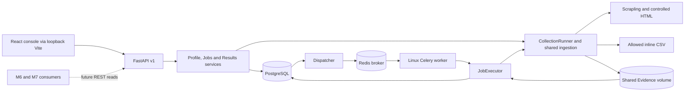

# M5 Core Architecture Review

2026-11-14，香港時間。M4 delivery 為 `aabe86502d688ddb9000fd3e970a7c7fadcc49fc`。Backend、Frontend 和 Compose 檔與 `439e1a2b1e98f4d3bf53919ec07507e8df099ece` 一致。決策依 M0-01～03、M2-01～03、M3-01～04 和 M4 Closure contract。正式人類同儕覆核待另行安排。 [M0 ADR](../decisions/M0-architecture-decisions.md) · [M3 ADR](../decisions/M3-reliability-decisions.md)

| 邊界 | 審查結果 |
| --- | --- |
| Modular monolith | API、CLI 與 Worker 共用同一 Python package 和 contracts。API 負責 transport／DTO，application services 管理 use case、交易及錯誤，Core 管理 input、adapter、validation、identity，persistence 管 ORM、constraints 和 migration。只有 Dispatcher 決定何時派送。 |
| Source／Profile | 設定及 access policy 分開。相同 Source 的寫入共享 row lock；Validation 先做 I/O，再在寫入時重新核對 Source、Draft revision 和 hash。Approve 需要當前 passing report；DB trigger 保護已核准的內容。 |
| Job／Worker | Job 與 dispatch intent 在同一 transaction。Dispatcher 對 due rows 使用 `SKIP LOCKED`；Worker claim 遞增 attempt 並設固定 90 秒 lease。Fencing 檢查來自 PostgreSQL 時間和 Job row lock。Celery 以 JSON Job UUID 工作，Redis 可遺失訊息，pending row 仍可重派。 |
| Integrity／Evidence | Shared ingestion 先驗證及 normalize，再在單一 Job 內由首個合法 identity 勝出。Evidence volume 先發布檔案；後端重讀 bytes／metadata，將 Evidence metadata、Records、Quarantine、counts 和終態寫入同一 DB transaction。SQL composite FKs 保護 lineage。 |
| Console／Consumers | Console 經 HTTP、以可重送的 request key、Draft revision 和有界 polling 工作。Downstream 可按 Job ID 取得 terminal snapshots 及已驗證 Records。 |

## Findings and scope

| 優先次序 | 風險與處理 |
| --- | --- |
| 已修正 | `backend/core/web_adapter.py` 以真實 loopback HTTP 重現 robots 判斷與 libcurl dot-segment 正規化差異。送出前拒絕 literal／decoded dot-segments 及 encoded separators；redirect 重驗。Scrapling fetch 使用 context-local 停用 logger，synthetic URL marker 只留 Evidence lineage。 |
| 已修正 | `backend/core/html_extraction.py` 在保留候選數限制下，另把解析後文字值累計限制於 1 MiB UTF-8。測試以約 93 KB HTML 和全域 XPath 觸發 `extraction_size_limit`，避免重複物化放大的值。 |
| 中 | `application/execution.py`、`queue/dispatcher.py` 及 `application/jobs.py` 共用 Job internal helpers，跨 module 呼叫私有方法。鎖順序、lease 檢查和 terminal 發布適合在同一協調點。M5 保留現有結構，回歸重點是交易行為。 |
| 中 | M1 的 `ProfileRepository` 及 M2 的 PostgreSQL layer 有各自的 lifecycle 狀態表示。Application 把 ORM rows 轉成短期 snapshot，重用 M1 規則；寫入 DB 時另外依賴 locks、constraints、triggers。變更 state machine 時須同步核對三處。 |
| 中 | Broker outage 期間未 claim 的 Job 可重派，`DISPATCH_FAILED` 及 unpaged events 可長期累積。固定 execution budget 為 3 attempts。Source、Profile、Events 清單無 server-side paging，Evidence storage 無 quota／retention。 |
| 中 | `M3_COMPOSE_FIXTURE=1` 影響 Source DTO policy 驗證，包括讀取已存在的 fixture Source。驗收 project 須維持 fixture overlay 和獨立 DB，避免把合成資料配置帶入其他環境。 |
| 中 | Shared volume 和 PostgreSQL 有獨立 commit points。失敗或 stale attempt 可留下 orphan，已提交 metadata 可在檔案遭事後修改時仍被讀取。現有 checksum 為發布時及後端操作時的 integrity control。 |
| 低 | HTTP 共用 error envelope 與 OpenAPI 成功模型同時存在，但各路由未枚舉所有錯誤回應。前端會區分 transport、HTTP、JSON parse failure，JSON shape 主要依賴 TypeScript 和合約測試。 |

可信本機 operator 可直接呼叫 API。Loopback Host／Origin、固定 fixture DNS 和不跟隨跨 origin redirect 的規則界定現有受控運行邊界。公開來源需另行設計 DNS／連線位址驗證及 egress policy。 [OWASP SSRF Prevention](https://cheatsheetseries.owasp.org/cheatsheets/Server_Side_Request_Forgery_Prevention_Cheat_Sheet.html)
