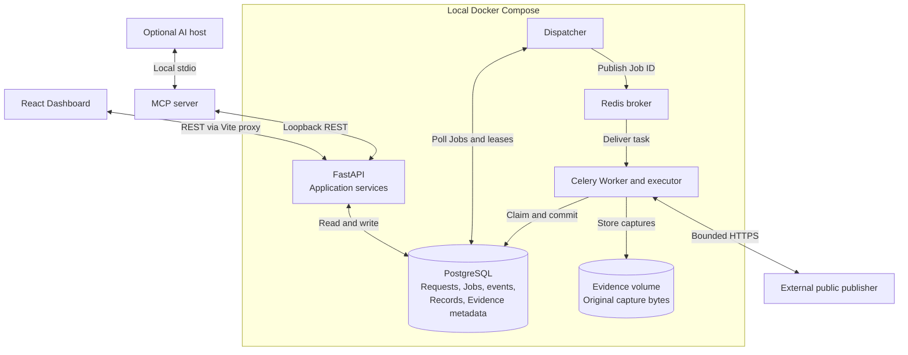

# System Overview

**Adaptive Scalable and Observable Web Data Collection Platform** is the formal final-year project title. **Reusable Web Data Collection Platform** describes what the Core does. It turns approved web pages and allowlisted CSV inputs into validated, exportable Records with traceable Evidence. The downstream industry application remains open.

## Local architecture

The Windows launcher runs the React Dashboard through Vite and starts the backend services in Compose. The Dispatcher polls PostgreSQL for due work and recovers expired execution leases. Redis carries task messages. PostgreSQL holds durable state and lineage, and the local Evidence volume holds original capture bytes. Standard collection works without an external LLM. An optional AI host runs `python -m mcp_access.server` over stdio for discovery, controlled submission and status or lineage reads through the same API. [Compose services](../../compose.yaml) · [Worker contract](../contracts/M3-job-execution-contract.md) · [Windows setup](../setup/Windows-One-Click-Setup.md) · [MCP setup and walkthrough](../setup/Windows-MCP-Access.md)

## From an approved source to an export

1. **Authorise the Source.** In **Sources**, register and authorise the permitted origin and paths. In a trusted Normal installation, enable local approval before setting up real sources. Public collection observes robots rules and shared per-origin and per-run bounds, rechecks destinations and stops on explicit blocking. Public HTTPS uses `curl_cffi` with vetted DNS addresses, TLS verification and policy-checked redirects. Controlled HTTP fixtures use Scrapling's Fetcher. Scrapling selectors extract from captured HTML on both paths. [Windows approval settings](../setup/Windows-One-Click-Setup.md#settings-data-and-the-controlled-demo) · [Controlled website contract](../contracts/M7-controlled-website-collection.md)
2. **Approve how to extract.** Set **Collection mode** to **Keyword search and detail pages**, configure selectors and required fields, then preview and validate a draft using a sample keyword. FastAPI runs these checks through the Core before collection. Explicitly approve the resulting immutable Profile Version. In **Topics & bindings**, approve a binding from the Topic to that Source and Profile Version. [Source and profile workflow](../contracts/M7-controlled-website-collection.md#operator-workflow) · [Topic workflow](../contracts/M8-data-identity-collection-management.md#console-workflow)
3. **Run and follow one Request.** In **New Collection**, choose one to four eligible bindings and enter the keyword. Use **Review collection**, then **Start topic collection**. The backend creates one child Job per binding with its Profile Version and configuration hash pinned. Replaying the same submission with its original key returns the existing Request and Job IDs. Open **Child jobs → Job details** to see who claimed each execution attempt and its outcome. A retry or lease recovery keeps the same Job ID. [Request contract](../contracts/M8-data-identity-collection-management.md#api) · [MCP submission and replay](../setup/Windows-MCP-Access.md#submit-one-topic-collection)
4. **Inspect and export.** Check **Child jobs**, open **View request records**, inspect a Record, then select **View capture evidence** to see its detail capture and SHA-256. A partial Request can retain Records from both succeeded and partial Jobs. Once all child Jobs finish, **Download CSV** and **Download JSON** include all accepted Records for the selected Request, independent of Data Explorer filters. Optional **Article history** links per-run Records to observations of an article and reuses the content version when it is unchanged. For an allowlisted CSV dataset, use **Collection Jobs → Single-source collection and CSV import**. That workflow preserves dataset and row provenance and involves no website traversal. [Article identity and versions](../contracts/M8-data-identity-collection-management.md#article-mapping-identity-and-versions) · [CSV example](../demo/M5.5-dashboard-demo-runbook.md) · [Export limits](../../README.md#record-exports)

## What the title means in practice

- **Adaptive.** Operators can configure publisher-specific links, selectors and field mappings. They validate and approve changes as new immutable Profile Versions, so earlier Jobs retain their original configuration. M18B approved an Economics Observatory version with a revised detail-link scope and a longer bounded timeout. [M18B profile approval](../evaluation/M18B-Live-Multi-Source-Acceptance.md#economics-observatory-approval-and-worker-runs)
- **Scalable.** Per-binding Jobs can run across worker replicas. In M10's controlled 36-Job CSV workload with 1,200 rows per Job, median end-to-end throughput was 3.82, 6.41 and 9.53 Jobs/s with one, two and four Workers. Four keyword Jobs sharing a fixture origin stayed near 0.34–0.35 Jobs/s across those configurations under a shared one-second origin limit. [M10 workloads and measured results](../evaluation/M10-Scalability-Evaluation.md#three-repetition-medians)
- **Observable.** Job states, dispatch and execution attempts, events and accepted counts show each binding's outcome. Each Celery node has a public ID for its current startup. PostgreSQL stores that ID with the attempt's claim, so Job Details can still distinguish the original Worker and a recovery Worker after services restart. Record lineage connects the result to the Source, pinned Profile Version, Job, capture time and Evidence ID and hash. [Job execution contract](../contracts/M3-job-execution-contract.md) · [Worker recovery evidence](../evaluation/M20-Worker-Attempt-Identity.md) · [Verified detail lineage](../evaluation/M18B-Live-Multi-Source-Acceptance.md#record-to-detail-evidence-verification)

## Live evidence and limits

On 20 November 2026, the M18B MCP Request for `inflation` retained one accepted Record each from Welsh Government and Scottish Fiscal Commission. The parent was partial because the Scottish Job reached its detail limit. A separate successful Request supplied the Economics Observatory result. Across the live M18B evaluation, three independent publishers produced four succeeded Jobs, two partial Jobs, two failed Jobs and six accepted Records. The report reconciles the Request exports and verifies the stored detail bytes by SHA-256. These results came from a configured Normal environment. The Synthetic Demo seeds reproducible fixture Records, and fresh Normal mode starts empty. [Shared Request and Jobs](../evaluation/M18B-Live-Multi-Source-Acceptance.md#real-requests-and-worker-results) · [Final live results](../evaluation/M18B-Live-Multi-Source-Acceptance.md#timeout-validation-and-final-acceptance-on-20-november-2026-utc) · [Synthetic Demo](../evaluation/M16-FYP-Presentation-Runbook.md)

The system is for trusted local operation and bounded, approved access. Publisher availability, site structure and access rules can change. Final integrated release verification and a cold start on a physical 8 GB Windows host remain open. [M21 follow-up](../evaluation/M18-Real-Source-and-Follow-Up-Plan.md#m21-verify-the-integrated-release) · [Physical 8 GB acceptance](../evaluation/M10-Deployment-Verification.md#physical-8-gb-acceptance)
